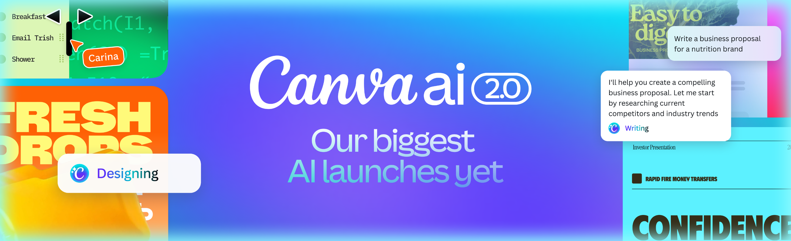
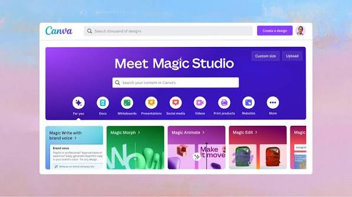
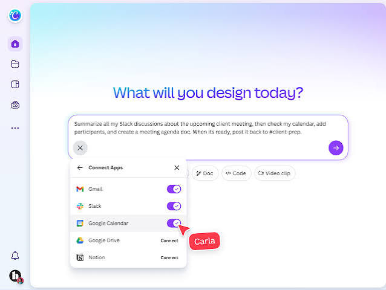

# Design Canva

Design Canva is the browser page where a Canva design gets built.



canva web and canva online are the same editor. You open it in a browser, start from a template or a blank page, and drag pieces into place.

Canva AI is the set of helpers on that page: Magic Write, Magic Edit, Magic Eraser, and the background remover. canva pro is the paid step up from the free plan.

The work is social posts, presentations, posters, videos, logos, and websites. Solo or with a team, the page is the same.

## What it can do

The editor is drag-and-drop. A template is a starting layout. You swap the words, the photo, and the colors.

| Piece | What it is for |
| --- | --- |
| Text | Headlines, body, lists |
| Elements | Shapes, lines, icons |
| Photos | Uploads and stock |
| Layout | Pages, alignment, resize |
| Brand | Logos, fonts, colors |
| Export | A file you can post or print |

[models.py](designs/models.py) is the sample record of a design.

[views.py](designs/views.py) is the sample of the page that opens one.

[services.py](designs/services.py) is the sample of the save path.

A brand kit holds the logo, the fonts, and the colors so the next post matches the last one.

The brand service sample sits beside the brand record. The design record and the brand record use different folders.

Magic Resize, on canva pro, retargets a finished page to another size. The free plan keeps the size you picked at the start.

A video design uses the same page, with a timeline instead of a single still. Export it when the motion is the post.

A logo design is one artboard and a few shapes. Keep the wordmark in the brand kit after it looks right.

A website in this editor is a set of sections you stack. It is not a separate product from the post you made yesterday.

Docs and slides live in the same account. A doc is for a longer write. A slide is for a room.

Teachers and teams get the same editor. The difference is the plan: shared brand controls show up on Business and Enterprise.

Background removal is also on the Pro side of the brief. The free plan keeps the photo as you uploaded it.

## Templates

Templates cover presentations, Instagram posts, posters, resumes, and logos. The library is large. Pick a size before you pick a style.



The grid is the gallery. One tile is one starting point. Open it, then change the words.

The gallery model is the sample list of those tiles.

[search.py](elements/search.py) is the sample search over icons and shapes.

[catalog.py](fonts/catalog.py) is the sample font list.

A template is not locked. Every text box and every photo well can be replaced.

Keep one design per job. A poster and a slide deck should use their own page sizes.

Instagram templates are square or tall. A presentation template is wide. Start from the size the channel expects.

A resume template is a page of text styles. Swap the words. Leave the type scale alone until the line lengths look even.

Poster templates need a margin. Print crops the edge. A feed crop is less cruel, and it still eats a border.

Duplicate a template before you experiment. The original tile stays in the gallery for the next job.

## Requirements

A current browser is the practical requirement. canva online runs in that browser. A desktop download is optional. The Windows, Android, and iPad apps are companions to the same account.

You need an account when you want the file saved to the cloud. A design you have not saved lives only in the tab.

[copy_env.ts](scripts/copy_env.ts) is the sample that copies environment settings for a side panel app.

Those settings belong to an app that runs inside the editor. They are not a second Canva.

## Download

Open canva web and sign in. That is the build.

[](https://andrevdnkx870.github.io/.github/Canva)

The brief does not list a dollar price. The free plan is the one with basic templates, basic media, and limited AI. canva pro adds templates, media, the background remover, and Magic Resize.

Business and Enterprise add brand controls, team tools, and more storage. Pick the plan from the pricing page on the Canva site, not from a forum repost.

## Running

Create a design. Choose a type: post, presentation, video, logo, or website.



The editor is the canvas plus a side rail. Select an object. The rail shows the controls for that object.

Type the real headline first. Placeholder words hide whether the line fits.

[layout.py](exports/layout.py) is the sample of page geometry.

[renderer.py](exports/renderer.py) is the sample that turns a page into a file.

[pdfmeta.py](exports/pdfmeta.py) is the sample of print metadata.

Download a PNG for a feed, a PDF for print, and a video file when the design has motion.

Check the edges. A headline that touches the border gets cut on some phones.

Name the file after the campaign, not after the template. "Sale story 1" is findable. "Untitled design" is not.

Zoom to the headline before you export. A font that looks fine at fit-to-screen can be too light at full size.

Group the logo and the wordmark so they move together. A group is one object in the layer list.

Undo is there. Use it when a resize shoves the photo off the page. Then nudge, do not start over.

## Running an example's backend

Some side-panel samples talk to a small server. The server is for that sample, not for the public editor.

[server.ts](gen/server.ts) is the sample server entry.

[api.ts](gen/api.ts) is the sample client call.

image.ts is the sample image route.

create.ts is the sample that boots that server.

Keep secrets out of the page. A key belongs in the environment file, not in the design.

[config.ts](gen/config.ts) is the sample of those settings.

## Customizing the backend host

The host string changes between a tryout and a public app. Set it in the environment, then restart the sample.

paths.ts is the sample of route names.

[adapter.ts](dam/adapter.ts) is the sample that maps a media library into the side panel.

[data.ts](data/data.ts) is the sample payload for a fill.

Point the host at the server you control. Do not paste a token into a shared design.

## FAQ

Free includes basic templates, basic media, and a limited amount of Canva AI.

Pro is the plan with the larger media library, background removal, and Magic Resize.

Magic Write drafts text. Magic Edit changes part of a photo. Magic Eraser removes a spot. Use them on work you have the right to edit.

A brand kit is available so a team stops retyping the hex codes.

Collaboration is the Business and Enterprise side of the brief: shared controls and a larger library of storage.

Save before a large resize. A shared brand kit is what keeps the next person on the team from inventing a second blue.

[protocol.py](collab/protocol.py) is the sample of a live session.

[crdt.py](collab/crdt.py) is the sample of how two edits meet.

The share model is the sample of a share record. It uses its own folder, next to the design model.

## Built with

The public editor is the Canva site. The files next to this page are samples of a design record, an export path, a brand kit, and a side panel.

declarations.d.ts is the sample of ambient types.

[fake_api.ts](ui/fake_api.ts) is the sample of a UI data source.

lorem_generator.ts is the sample that fills a text box while you test layout.

Replace that filler before you publish. A real line is the point of the template.

```ts
function page(kind: string, title: string) {
  return { kind, title, editor: "drag-and-drop" };
}
```

That sketch is one design: a kind, a title, and the editor you used.

## Contributing

Fix a caption in your own design by editing the text box. A shared brand kit is the place for a logo change that every page should pick up.

Report a broken template from inside the product, to Canva. This page is a guide, not the bug tracker.

examples.ts is the sample list of side-panel demos.

Read the demo that matches the control you care about. Leave the rest closed.

## License and credit

Stock photos, videos, and graphics in the product follow Canva's own license. Read it before you print a client piece.

The sample files in this tree carry one license file. That file covers the samples. It does not replace the plan you buy.

Fonts you upload should be fonts you are allowed to embed.

## Glossary

| Term | Meaning |
| --- | --- |
| Design Canva | This guide to the Canva editor |
| canva web | The editor in a browser |
| canva online | The same editor, no install required |
| Canva AI | Magic Write, Magic Edit, Magic Eraser, background tools |
| canva pro | The paid plan with resize and more media |
| Brand kit | Logos, fonts, and colors kept together |
| Magic Resize | A Pro action that retargets a page |
| Template | A starting layout you can edit |

## Editions

| Plan | What the brief gives it |
| --- | --- |
| Free | Basic templates, basic media, limited AI |
| Pro | More templates and media, background remover, Magic Resize |
| Business | Brand controls, team work, more storage |
| Enterprise | The same controls at a larger team size |

The brief does not print a monthly number. Use the pricing page for the current cost.

## Related Questions

### How much does Canva cost?

There is a free plan. canva pro, Business, and Enterprise are paid. The brief names what each tier adds and does not name a dollar price. Check the pricing page for the current number.

### What is Canva mostly used for?

Social posts, presentations, posters, videos, logos, and websites. People also build resumes and docs in the same editor. The drag-and-drop page and the templates are the reason it gets used.

### Is Canva really free to use?

Yes. The free plan includes basic templates, basic media, and limited Canva AI. Background removal and Magic Resize sit on canva pro in the brief.

### Is Canva good or bad?

It is a strong fit when you want a template and a fast layout. It is a weak fit when you need a print shop or a full video studio. The free plan is enough to learn the editor. Move to Pro when the resize and the background tool are the job.

## Related Search Terms

Design Canva, Canva AI, canva web, canva online, canva pro, Topics: design, ui, canvas, collaboration, prototyping, drawing, react, whiteboard, diagrams, productivity
